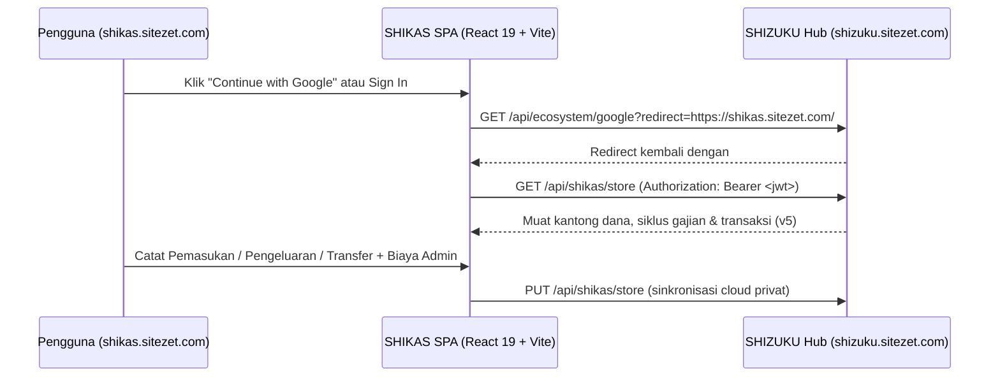

# shikas (雫) — Personal Cashflow

> **Aplikasi Pencatat Arus Kas Pribadi, Manajemen Multi-Kantong Dana, & Analitik Siklus Gajian dalam Rupiah (IDR) yang Tenang, Akurat, dan Terhubung dengan `SHIZUKU ID`**

[](https://shikas.sitezet.com)
[](https://shizuku.sitezet.com)
[](https://react.dev/)
[](https://www.typescriptlang.org/)
[](https://vite.dev/)
[](https://tailwindcss.com/)
[-22b5bf?style=flat-square)](https://recharts.org/)

**shikas (雫)** adalah aplikasi web pencatatan keuangan pribadi (*personal cashflow tracker*) yang menjadi aplikasi pendamping utama dalam ekosistem **SHIZUKU (雫)**. Dirancang dengan estetika galeri minimalis yang menenangkan dan perhitungan kas riil yang akurat, **SHIKAS** memisahkan secara tegas antara **uang harian**, **tabungan**, **perpindahan saldo antar-kantong (*transfer*)**, dan **biaya admin bank**—sehingga saldo setiap kantong, total pengeluaran, serta rasio tabungan selalu presisi tanpa kesalahan hitung ganda (*anti double-counting*).

🔗 **Akses Production Live**: [https://shikas.sitezet.com](https://shikas.sitezet.com)  
🔗 **Pusat Ekosistem & Akun (SHIZUKU Hub)**: [https://shizuku.sitezet.com](https://shizuku.sitezet.com)

---

## 🌟 Fitur & Modul Utama

1. **Beranda Galeri Minimalis (`HOME`)**
   - Tampilan sampul bergaya galeri yang tenang di atas latar *watercolor* khas SHIZUKU dengan efek rintik hujan lembut (*Shizuku rain layer*).
   - Akses langsung menuju buku kas aktif tanpa distraksi elemen berlebihan.

2. **Manajemen Multi-Kantong Dana (`Pockets`: `DAILY` & `SAVINGS`)**
   - Kelola berbagai sumber dana secara terpisah (misal: *GoPay*, *Wondr*, *BCA*, *Tunai*, *Rekening Tabungan*) melalui **Manage Pockets Modal**.
   - Setiap kantong memiliki peran khusus (**`DAILY`** untuk operasional harian atau **`SAVINGS`** untuk tabungan), warna identitas, saldo awal (*opening balance*), serta pengaturan kantong default.
   - Strip saldo kantong (*Pockets Strip*) menghitung posisi saldo aktual tiap rekening secara *real-time* dari saldo awal + seluruh histori mutasi.

3. **Pencatatan Pemasukan, Pengeluaran & Transfer Antar-Kantong (`CASHFLOW`)**
   - Pencatatan cepat dalam format Rupiah (**IDR / `Rp`**) dengan **kategori ringkas & terstruktur**:
     - **Pemasukan (2 kategori)**: 💼 Gaji (*Salary*) · ➕ Lainnya (*Other*)
     - **Pengeluaran (8 kategori)**: 🍽️ Makan & Minum · 🏠 Tagihan & Kost · 🚆 Transportasi · 🛍️ Belanja · 🎵 Hiburan · 🎁 Berbagi · 🏦 Admin Bank · 🧾 Lainnya
     - **Transfer (1 kategori khusus)**: ⇄ Pindah saldo antar-kantong secara internal.
   - **Akuntansi Harian vs Tabungan & Biaya Admin Akurat (`feeIdr`)**: Saat melakukan transfer dari *Daily* ke *Savings* (misal Rp 3.000.000 dengan biaya admin Rp 2.500), saldo sumber berkurang `Rp 3.002.500`, saldo tujuan bertambah `Rp 3.000.000`, `NET CASHFLOW · DAILY` mencerminkan sisa arus kas harian non-tabungan, **`SAVINGS FLOW`** melacak arus bersih tabungan, dan **hanya biaya admin Rp 2.500** yang dihitung sebagai pengeluaran murni—sementara pengeluaran langsung dari kantong *Savings* tetap tercatat penuh di `Expense` & `Analytics`.
   - **Sistem Reimburse Fleksibel & Anti-Kotor (`REIMBURSE // 雫`)**: Tandai pengeluaran talangan/patungan dengan toggle *Reimburse* (nama pengutang & target nominal bersifat opsional/fleksibel). Pembayaran balik (sebagian/`SEBAGIAN` maupun langsung `LUNAS` di nominal berapa pun) langsung menambah saldo kantong tujuan (bisa beda kantong, mis. bayar via *GoPay* lalu diganti ke *Wondr*) dan mengurangi pengeluaran bersih pada siklus transaksi aslinya **tanpa mengotori `Income`**. Dilengkapi panel pengingat `MENUNGGU REIMBURSE // 雫` lintas bulan dan tab filter **`REIMBURSE`** di `CASHFLOW LOG`.
   - **Raindrop Vessel & Filter Cepat**: Indikator visual rasio *Saved vs Spent*, filter jenis transaksi (`ALL · INCOME · EXPENSE · TRANSFER · REIMBURSE`), filter per kantong, pencarian catatan/merchant/pengutang, serta pengelompokan harian.

4. **Siklus Gajian Kustom per Akun (`Custom Payday Cycle: Day 1–28`)**
   - Bebas menentukan tanggal mulai siklus bulanan sesuai jadwal gajian masing-masing pengguna (default tanggal `1`, dapat diubah ke `1–28`, misalnya tanggal `25` → periode aktif `25 Nov – 24 Dec`).
   - Pengaturan siklus tersinkron otomatis ke akun **SHIZUKU ID** dan diterapkan konsisten di seluruh ringkasan **Cashflow** maupun grafik **Analytics**.

5. **Analitik Arus Kas Interaktif (`ANALYTICS` — *Lazy-Loaded*)**
   - Modul grafik `recharts` dimuat secara *lazy* (tidak membebani waktu muat awal aplikasi).
   - Mendukung **4 rentang waktu dinamis**: `3M`, `6M`, `12M`, dan `ALL TIME` mengikuti tanggal siklus gajian pengguna.
   - Visualisasi lengkap: **Composed 3-Bar + Line Chart** (perbandingan Pemasukan, Pengeluaran Bersih, **Arus Tabungan**, & Total Net lengkap dengan tooltip *Daily Net* & *Reimbursed*), **Donut Chart** proporsi pengeluaran bersih per kategori, **Dual Area Chart** tren **Total Saldo** vs **Saldo Tabungan**, serta ringkasan *SHIZUKU Chronicle* (termasuk rangkuman reimburse).

6. **Mode Lokal Instan & Sinkronisasi Cloud Privat (`SHIZUKU ID` + Google Sign-In)**
   - **Offline-First (`LOCAL MODE`)**: Langsung dapat dicoba tanpa wajib membuat akun; seluruh data tersimpan aman di `localStorage` browser.
   - **Cloud Sync Privat (`DB SYNCED`)**: Masuk dengan email/password atau **Continue with Google** melalui [shizuku.sitezet.com](https://shizuku.sitezet.com) untuk menyinkronkan kantong dana, transaksi, dan siklus gajian ke database SQLite terisolasi per akun (`PUT /api/shikas/store` *debounced*).

7. **Kontrol Privasi, Bahasa & Kenyamanan Harian (`Account Panel`)**
   - **Dwibahasa Instan (`EN | ID`)**: Mendukung Bahasa Inggris (*default*) dan Bahasa Indonesia secara menyeluruh.
   - **Privacy Mask (`Rp ••••••`)**: Sembunyikan seluruh angka nominal dalam satu klik saat membuka aplikasi di tempat umum.
   - **Ambient Rain Toggle**: Aktifkan atau nonaktifkan animasi rintik hujan sesuai selera.

8. **Ekspor CSV & Cadangan JSON Tervalidasi (`Export & Backup/Restore v5`)**
   - **Ekspor CSV (UTF-8 BOM, 18 Kolom Siap Excel/Sheets)**: Mengunduh riwayat transaksi (`shikas-cashflow-YYYY-MM-DD.csv`) berisi *Date, Cycle, Type, Category, Pocket, To Pocket, Merchant, Note, Gross Amount, Admin Fee, Reimburse Status, Reimburse From, Reimburse Target, Reimbursed, Net Income, Net Expense, Reimburse To Pocket,* dan *Reimburse Payments Detail* (dengan proteksi *formula injection* & kecocokan `SUM` 100%).
   - **Backup & Restore JSON v5**: Unduh cadangan utuh seluruh kantong, transaksi (termasuk histori cicilan reimburse), pengaturan siklus gajian, dan ringkasan saldo (`shikas-backup-YYYY-MM-DD.json`), lengkap dengan sanitasi tipe data dan migrasi otomatis untuk kategori *legacy* saat *restore*.

---

## 🏗️ Arsitektur & Teknologi



| Komponen | Teknologi | Keterangan |
| :--- | :--- | :--- |
| **UI Library** | [React 19](https://react.dev/) | Arsitektur SPA ringan dengan React Context & lazy-loaded route view |
| **Bahasa** | [TypeScript 5.8](https://www.typescriptlang.org/) | *Strict type checking* penuh pada model transaksi v5 & kalkulasi kas |
| **Build Tool** | [Vite 6](https://vite.dev/) | *Code splitting* otomatis (`index ~105 KB` gzip, `charts` dimuat terpisah) |
| **Styling** | [Tailwind CSS v4](https://tailwindcss.com/) | Estetika *minimalist pastel gallery*, responsif `360px` hingga desktop |
| **Visualisasi** | [Recharts](https://recharts.org/) & [Lucide React](https://lucide.dev/) | Grafik arus kas responsif yang dimuat *on-demand* di tab Analytics |
| **Backend Sync** | [`shizuku-php`](https://github.com/farhansatrian/shizuku-php) (`shizuku.sitezet.com`) | REST API v5 + SSO `SHIZUKU ID` (Cookie `.sitezet.com` & Bearer JWT) |

---

## 🖥️ Infrastruktur & Spesifikasi Deployment

Karena **SHIKAS** terkompilasi menjadi berkas statis murni (`dist/`), aplikasi ini berjalan super ringan tanpa membutuhkan runtime Node.js maupun PHP di server:

- **Alamat Domain Publik**: [https://shikas.sitezet.com](https://shikas.sitezet.com)
- **Backend API & SSO Target**: [https://shizuku.sitezet.com](https://shizuku.sitezet.com)
- **Tipe Hosting**: Shared Hosting (cPanel / Apache Static SPA dengan `.htaccess` *fallback* ke `index.html`, kompresi gzip, & *immutable cache* aset hash)
- **Ukuran Initial Load**: ~`105 KB` gzipped JS + `~9.8 KB` gzipped CSS (paket `charts` ~`121 KB` gzip baru diunduh saat pengguna membuka tab **Analytics**)
- **Opsi Alternatif Docker (VPS)**: Tersedia juga `Dockerfile` (`nginx:1.27-alpine`, ~`15 MB RAM`, port `8080`, endpoint `/health`) serta `compose.prod.yaml` jika suatu saat ingin dideploy di VPS.

---

## 🚀 Menjalankan Proyek di Lingkungan Lokal (Development)

### Prasyarat
- **Node.js** v20.x atau lebih baru
- **npm** v10.x atau lebih baru
- *(Opsional)* Instance lokal [`shizuku-php`](https://github.com/farhansatrian/shizuku-php) di `http://127.0.0.1:8088` jika ingin menguji sinkronisasi cloud & login secara lokal.

### 1. Klon Repository & Instal Dependensi
```bash
git clone https://github.com/farhansatrian/shikas.git
cd shikas
npm install
```

### 2. Konfigurasi Environment Variable (Opsional)
Salin konfigurasi contoh jika ingin menghubungkan ke backend **SHIZUKU** (kosongkan kedua variabel jika hanya ingin menjalankan *Local Mode*):
```bash
cp .env.example .env
```

Isi variabel pada `.env`:
```env
# Arahkan ke backend SHIZUKU lokal (http://127.0.0.1:8088) atau production
VITE_SHIZUKU_URL="https://shizuku.sitezet.com"
VITE_SHIZUKU_API_URL="https://shizuku.sitezet.com"
```

### 3. Jalankan Development Server
```bash
npm run dev
```
Akses aplikasi di browser melalui [http://localhost:5173](http://localhost:5173).

### 4. Build Production untuk Shared Hosting (`shikas.sitezet.com`)
```bash
VITE_SHIZUKU_URL="https://shizuku.sitezet.com" \
VITE_SHIZUKU_API_URL="https://shizuku.sitezet.com" \
npm run build
```
Unggah seluruh isi folder `dist/` beserta `.htaccess` SPA *rewrite* ke *document root* `shikas.sitezet.com`.

---

## 🧪 Verifikasi & Quality Gates

Standar pemeriksaan kualitas sebelum kompilasi dan rilis ke production:

```bash
# 1. Pengecekan Type Safety TypeScript (strict)
npm run typecheck

# 2. Kompilasi penuh TypeScript & bundle production Vite (verifikasi code-splitting)
npm run build
```

### Cakupan Verifikasi End-to-End (Teruji Live dengan `shizuku-php`):
- **Integrasi Cross-Origin (`CORS` & `Bearer JWT`)**: Pengujian penuh preflight `OPTIONS`, registrasi akun baru, login, logout, dan pembacaan `#shizuku_token` Google OAuth.
- **Akurasi Ledger v5**: Verifikasi perhitungan saldo lintas kantong `DAILY` & `SAVINGS`, transfer beserta biaya admin (`feeIdr`), serta pergantian rentang tanggal siklus gajian (`cycleStartDay = 25`).
- **Persistensi & Isolasi Data**: Hard-reload maupun logout → login ulang memulihkan 100% data dari SQLite `shizuku-php` tanpa bocor ke akun lain.
- **Responsif Mobile**: Verifikasi viewport `360px` dan `390px` dengan *zero horizontal overflow*.

---

## 📦 Cadangan & Pemulihan Data Pengguna (Backup & Restore)

Selain tersinkron otomatis ke cloud **SHIZUKU ID**, setiap pengguna dapat mencadangkan datanya kapan saja langsung dari menu **Account Panel**:

- **Export CSV**: Menghasilkan `shikas-cashflow-YYYY-MM-DD.csv` (UTF-8 BOM) untuk arsip spreadsheet atau analisis eksternal.
- **Export JSON Backup**: Menghasilkan `shikas-backup-YYYY-MM-DD.json` berisi seluruh daftar kantong, histori transaksi, dan preferensi v5.
- **Import / Restore JSON**: Mengunggah kembali file backup JSON dengan validasi struktur otomatis (`parseBackupJson`) dan langsung menyinkronkan ke cloud jika akun sedang masuk.

---

## 📄 Lisensi & Ekosistem

Proyek ini dikembangkan oleh **Farhan Satria Nugraha** sebagai bagian dari ekosistem web personal **SHIZUKU (雫)**:

- **SHIKAS Cashflow (Live)**: [https://shikas.sitezet.com](https://shikas.sitezet.com) · [`farhansatrian/shikas`](https://github.com/farhansatrian/shikas)
- **SHIZUKU Hub (Live)**: [https://shizuku.sitezet.com](https://shizuku.sitezet.com) · [`farhansatrian/shizuku-php`](https://github.com/farhansatrian/shizuku-php)
- **KostKas / SHIKOST**: [`farhansatrian/kostkas`](https://github.com/farhansatrian/kostkas)
