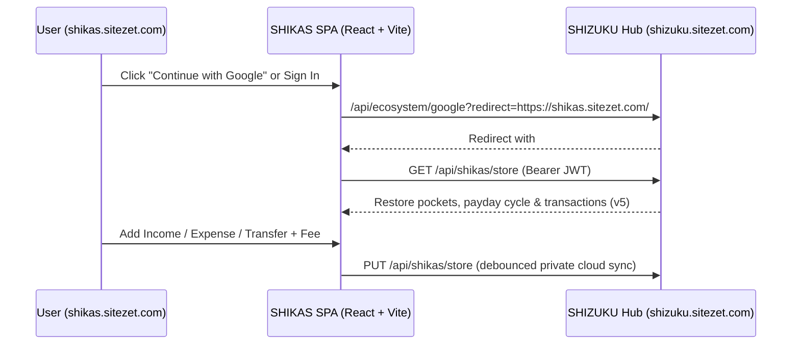

<div align="center">

# shikas (雫) — Personal Cashflow

**Minimalist gallery-inspired personal cashflow, multi-pocket & payday cycle tracker in IDR — companion web app in the SHIZUKU (雫) ecosystem.**

[](https://shikas.sitezet.com)
[](https://shizuku.sitezet.com)
[](#tech-stack)
[](#tech-stack)
[](#tech-stack)

</div>

---

## Live Ecosystem

| App | Description | Live URL | Repository |
| :--- | :--- | :--- | :--- |
| **SHIKAS (雫)** | Personal Cashflow, Pockets & IDR Analytics SPA | **[shikas.sitezet.com](https://shikas.sitezet.com)** | [`farhansatrian/shikas`](https://github.com/farhansatrian/shikas) |
| **SHIZUKU (雫)** | Personal Hub, Portfolio CMS & Central `SHIZUKU ID` Server | **[shizuku.sitezet.com](https://shizuku.sitezet.com)** | [`farhansatrian/shizuku-php`](https://github.com/farhansatrian/shizuku-php) |

---

## Highlights & Features

### 3 Clean Modules + Interactive Account Drawer
- **`HOME`** — Serene gallery-framed cover over the SHIZUKU watercolor backdrop with instant entry into your cashflow ledger.
- **`CASHFLOW`** — Fast IDR (`Rp`) money tracking built for real daily habits:
  - **Multi-Pocket Accounts (`DAILY` & `SAVINGS`)** — Manage separate wallets/banks (e.g., *GoPay*, *Wondr*, *BCA*, *Cash*) with custom opening balances, role badges, and default pocket selection.
  - **Income, Expense & Inter-Pocket Transfers** — Record transfers between pockets with optional **admin fee (`feeIdr`)** tracking that automatically deducts from the source pocket and counts accurately in monthly expenses.
  - **Custom Payday Cycle (`Day 1–28`)** — Set your own monthly cycle start date (e.g. `25 Nov – 24 Dec`) synced per account instead of being forced into calendar month boundaries.
  - **Instant Filtering & Grouping** — Underline filters (`ALL · INCOME · EXPENSE · TRANSFER`), pocket filter, search, daily transaction grouping, net cashflow & savings-flow ratio bar.
- **`ANALYTICS`** *(lazy-loaded)* — Lightweight interactive Recharts visualizations (6-cycle income vs. expense bar/line trend, expense category donut breakdown, cumulative net balance area) plus automated spending insights.

### Seamless `SHIZUKU ID` Cloud Sync & Offline-First Mode
- **Works Immediately as Guest (`LOCAL MODE`)** — Try everything privately in your browser (`localStorage`) with zero sign-up required.
- **Single Sign-On with `SHIZUKU ID`** — Sign in with email/password or **Continue with Google** via [`shizuku.sitezet.com`](https://shizuku.sitezet.com) to privately sync pockets, transactions, and payday cycle settings across devices (`DB SYNCED`).
- **Utilities & Privacy Controls** — Instant **Bilingual `EN | ID`** toggle, **Privacy Mask** (`Rp ••••••`) for public viewing, ambient Shizuku rain toggle, **Export CSV**, and **Backup / Restore JSON**.
- **Mobile-First & Featherweight** — Tested down to `360px` / `390px` viewports; initial JS bundle is ~`105 KB` gzipped with `recharts` deferred until opening Analytics.

---

## Ecosystem Sync Flow



---

## Tech Stack

- **Frontend:** React 19, TypeScript 5, Vite 6, Tailwind CSS v4
- **Charts & Icons:** Recharts *(code-split / lazy-loaded)*, Lucide React
- **Currency & Localization:** Indonesian Rupiah (`IDR / Rp`) · Bilingual `EN` (default) & `ID`
- **Backend Sync Target:** [`shizuku-php`](https://github.com/farhansatrian/shizuku-php) (`https://shizuku.sitezet.com`) via REST API v5

---

## Quick Start (Local Development)

```bash
git clone https://github.com/farhansatrian/shikas.git
cd shikas
npm install
```

Optionally connect to a local or live `SHIZUKU` backend by creating `.env`:

```dotenv
# Leave blank to run in standalone Local Mode
VITE_SHIZUKU_URL="https://shizuku.sitezet.com"
VITE_SHIZUKU_API_URL="https://shizuku.sitezet.com"
```

Run dev server or production build:

```bash
npm run dev        # Start Vite dev server (http://localhost:5173)
npm run typecheck  # TypeScript check
npm run build      # Build static production bundle into dist/
```

---

## Production Deployment

Because **SHIKAS** compiles to a pure static SPA (`dist/`), it deploys effortlessly to **any shared hosting (cPanel/Apache)**, **Cloudflare Pages**, **Vercel**, or **Docker/Nginx**:

### Shared Hosting (cPanel / Apache)
1. Build pointing at your live SHIZUKU Hub:
   ```bash
   VITE_SHIZUKU_URL="https://shizuku.sitezet.com" \
   VITE_SHIZUKU_API_URL="https://shizuku.sitezet.com" \
   npm run build
   ```
2. Upload the contents of `dist/` to your subdomain root (e.g. `shikas.sitezet.com`) with an SPA `.htaccess`:
   ```apache
   RewriteEngine On
   RewriteCond %{REQUEST_FILENAME} !-f
   RewriteCond %{REQUEST_FILENAME} !-d
   RewriteRule ^ index.html [L]
   ```
3. Make sure `https://shikas.sitezet.com` is listed in `ECOSYSTEM_ALLOWED_ORIGINS` on your SHIZUKU Hub.

### Docker / Nginx (Optional)
A minimal `nginx:1.27-alpine` `Dockerfile` (`~15 MB RAM`, port `8080`, `/health` check) and `compose.prod.yaml` are also included for VPS deployments.

---

<div align="center">
  Crafted by <a href="https://shizuku.sitezet.com">Farhan Satria Nugraha</a> · Companion App of the <strong>SHIZUKU (雫)</strong> Ecosystem
</div>
